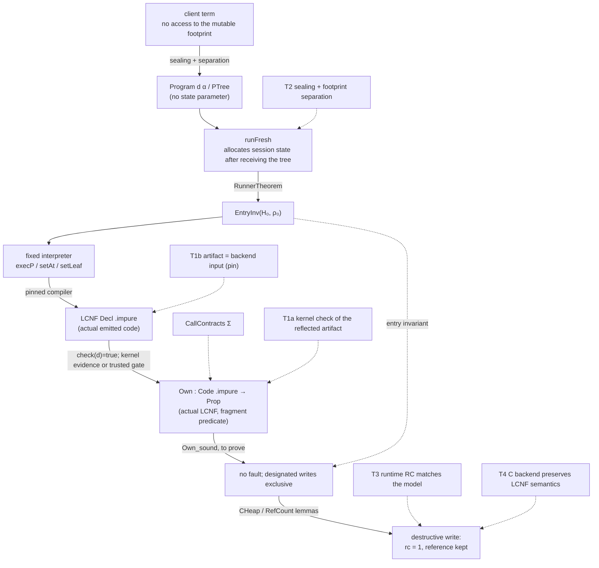

# The core result: a Lean type discipline that necessarily yields RC=1

Status: revised against `OWNERSHIP_PLAN_REVIEW.md` (24 October 2026). M0 — the
toolchain scaffold and a toy LCNF-acquisition smoke test — is in place and
verified. Nothing in the core theorem is proved yet. The first milestone is now
an **ownership (artifact) certificate for the generated executor under an
explicit entry invariant**, not a claim that the executor implements the source
interpreter.

---

## 0. Review dispositions

| Review | Disposition in this revision |
|---|---|
| §1 owned handles ≠ exclusive objects | Split the invariant into `OwnedHandle`, `PointsTo`, `Exclusive` and `Borrow`; the checker proves exclusivity from alias/count facts, never from a `borrow = false` annotation (§5.2, §5.4) |
| §2 initializer postcondition | `EntryInv` is now an explicit hypothesis of the first theorem; `Init d` must establish it or be checked against a contract; the repeated-child and client-retained-child cases are required tests (§5.3, §6, M3) |
| §3 non-escape → footprint separation | Replaced “no state-typed subterm” with `clientReachable ∩ mutableFootprint = ∅`; immutable observations are allowed to share, mutable cells are not (§5.6) |
| §4 absence of invalid writes | Semantics has explicit ownership faults; the theorem includes progress/no-fault from `EntryInv`, not only preservation; `Array.set` models both branches and the theorem proves the mutate branch is selected (§5.4) |
| §5 what the checker certifies | The plan now names four separate claims and labels the first an ownership/artifact certificate; “translation validation” is reserved for a proved correspondence (§1, §5.7) |
| §6 projection, calls, build identity | `Own` is defined on the actual LCNF (a fragment predicate, not a separate AST). Call summaries are semantic contracts. The backend-input link is a named trust step or proof obligation. The gate must yield kernel evidence or be listed as trusted (§5.4, §5.8, §7, §9) |
| §7 revised first theorem | Adopted: `check ∧ EntryInv ∧ CallContracts ⇒ no faults ∧ exclusive designated writes ∧ address preserved`, over every finite execution prefix (§1, §5.7) |
| §8 conditional refinement | Added `P_low(t) := ∃ s, P(s) ∧ R(s,t)` and the separate functional-correspondence layer (§5.9, M7) |
| §9 implementation order | M1–M7 reordered to inspect first, then entry invariant + small artifact theorem, then nested tests, joins, runner, backend link, source correspondence (§8) |

---

## 0.1 Status after this execution

| Milestone | State | Evidence |
|---|---|---|
| M0 scaffold | done | `nix develop -c lake build`; `scripts/probe-lcnf.lean` prints the toy shapes |
| M1 measurement | done for the write paths | `scripts/dump_executor.lean` replays the full mono + impure pipeline on the private declarations; `execP` size 39, digest `15626230893919229497`; `execR` size 46, digest `6897751127345717416`; `setAt` size 81, digest `17644656787385327013`; the `execP` set shape check passes |
| M2 fragment + soundness | done for the straight-line fragment | `Ownership/Heap.lean`, `Code.lean`, `Soundness.lean`; `check_sound` and the artifact theorems depend only on `propext`, `Classical.choice`, `Quot.sound` |
| M2 countermodels | done at the fragment/context level | `aliasSet_rejected`, `heldCtx` (`mult = 2`); the shared-target write is rejected |
| M3 entry invariant | done for the fresh-array initializer and the two nested countermodels | `Ownership/Entry.lean`: `initEntryInv`, `repeatedChild_not_unique`, `clientRetained_not_separated` |
| M4 full executor | **partial; recursive `Path.index` and one-pair reset/reuse modelled** | the top-level `execP` set alternative is recognized op by op in `OwnershipLcnf/Projection.lean` (exact operation order and argument identities; eleven token-preserving near misses rejected, including a branch-label exchange, a box-chain bypass and an argument-count case); `setAt`'s `Path.index` order is shape-checked (`checkArray=3, takeOut=5, checkElem=7, setAt=8, putBack=9`); `Ownership/Nested.lean` has `NCode`/`runN`/`checkN`/`checkN_sound` with a state-indexed extraction frame and a conservative exit rule, `OwnershipTest/Nested.artifact` for the one-level path, and `OwnershipTest/RecursiveProof.artifact` for a two-level root → child → leaf path with LIFO restoration and the stale-slot, shared-child and duplicated-handle refusals; the executable fixtures `OwnershipTest/Recursive.lean`, `WrongFrame.lean`, `OpenFrameReturn.lean` and `DistinctBinders.lean` assert the stale-slot, wrong-array put-back, open-frame-exit and aliased-binder refusals at the `checkN` boundary. Still open: generic joins and callbacks. The top-level `execP` set path's AST execution link is proved at M6. The one-pair `Path.left/right` reset/reuse model is `Ownership/Pair.lean` (`checkP`, `runP`, `copy_poststate`, `copy_inv`) with `OwnershipTest/PairBranchProof.lean` binding both unique branches and both shared copies, and `scripts/dump_executor.lean` checks the replayed alternatives' selected/retained/reuse/copy relations, rejecting token-preserving near misses, before printing the per-constructor `setAt branch report:` line |
| M5 runner/artifact | done for the measured write prefix | `Ownership/Runner.lean`: `initInv`, `execSet_check`, `artifact`; `Entry.artifact_entry` |
| M6 kernel gate | done for the `Code` artifact and, for the pinned update, for kernel-checked execution of the recognized emitted LCNF | `execSet_check` is a kernel proof; the emitted-LCNF link for the pinned `execP` set alternative is the recognizer plus `OwnershipLcnf.execAST`, which executes the trace the walk emitted for the declaration and returns nothing unless the declaration decodes to the expected prefix. The kernel-checked theorems are `execAST_recognized`, `prefix_simulates_model` (fragment level), `project_sound` (over the actual declaration), `projected_check`, `designated_write_in_place`, `initializer_designated_write_in_place`, `recognized_write_in_place`, `initializer_prefix_in_place` and `nonzero_prefix_in_place`, relative to the named primitive/backend contracts A1–A12 in `OwnershipLcnf/Semantics.lean`; they depend only on `propext`, `Classical.choice` and `Quot.sound`. A reified transcription of the captured declaration has its recognition, layout and checker acceptance kernel-checked in `scripts/check_projection.lean`. Not `check` on an arbitrary emitted AST, and not a backend-input identity |
| Priority-1 bridge (steering note) | done for the pinned scalar-array update; not a whole-executor claim | `OwnershipLcnf/Projection.lean` walks the replayed `execP` `PTree.set` alternative with the exact pre-bounds order, argument identities and primitive arities, selecting the bounds `Bool.true` alternative by constructor identity and never by position; `OwnershipLcnf/Semantics.lean` states the trusted primitive/backend contracts (A1–A12 in its header), executes the recognized code (`execAST`) and proves `project_sound` over the actual declaration, with the write's index and replacement written into the environment by the prefix's own projection and box rules from the node's reified fields; `recognized_write_in_place` gives the in-place outcome for arbitrary in-bounds index and replacement from `EntryInv`, `initializer_prefix_in_place` and `nonzero_prefix_in_place` instantiate it, and `designated_write_in_place` is the model-level form. `#print axioms` for the headline theorems lists `propext`, `Classical.choice`, `Quot.sound`. `scripts/check_projection.lean` accepts the real declaration, rejects eleven token-preserving near misses, and kernel-checks a reified transcription of the captured declaration. The index's own `inc`/`dec` pair and the continuation/recursive call are named non-claims |
| M7 source correspondence | **not done** | functional A2/A3 remain separate |

### Nested `Path.index` artifact

`Ownership/Nested.lean` adds the nested take-out path:

```lean
def code : NCode :=
  .takeOut 0 1 2 3 1
    (.callAt 3 5 6 4
      (.putBack 2 4 1 7 (.ret 7)))
```

`takeOut` requires the array's selected slot to hold the exclusive element `e`
(the `TakeOutOK` heap premise), binds the array and element to two *distinct*
fresh variables (the two sequential environment writes would otherwise collide),
and the checker's `mult e = 1` rule rejects a held pair (element still named
twice). `callAt` is the recursive `setAt` summary: it requires the extracted
state `mult = 1`, records the write `(e, true)`, and returns the state.
`putBack` stores the result into the array slot and moves the handles back.

The checker keeps an extraction frame stack. A take-out records the array, the
index variable, and the element it opened; a put-back must match the innermost
open frame (same array, index variable and element) before that frame is
popped. A second take-out from an array that already has an open frame (the
checker tracks frames per array, not per slot: reopening an array before
restoring it is outside one recursive path), a restoration into a different
array, a take-out whose two binder variables are the same, and a straight-line
block while a frame is open are refused. One extraction, and a nested extraction
from a *different* array, are accepted.

The exit is conservative: with no open frame an owned or scalar handle may be
returned, with exactly one open frame only that frame's extracted element may
return and only as an owned handle, and a deeper open stack is refused. The rule
is a checker contract rather than a consequence of `checkN_sound`; see the
non-claims below.

`checkN_sound` proves the nested run is fault-free, every recorded write is
exclusive, and the invariant is preserved, under `TakeOutsOK`: the heap premise
indexed by the state each step reaches, so a nested take-out's obligation is
stated on the heap its parent left and a put-back's on the heap the nested
take-out left. `OwnershipTest/Nested.artifact` is the one-level certificate.
`OwnershipTest/RecursiveProof.artifact` is the two-level certificate (root array
→ child array → leaf, `callAt` at the leaf, LIFO put-backs) and shows both slots
restored to their original elements; its `stale_rejected`, `shared_rejected` and
`incShared_rejected` theorems are the nested refusals, each paired with the
same-checker positive control `oneLevel_accepted`. `heldCode`/`heldCtx` is the
held-pair rejection. The four executable fixtures (`OwnershipTest/Recursive.lean`,
`WrongFrame.lean`, `OpenFrameReturn.lean`, `DistinctBinders.lean`, imported by
`OwnershipTest/RecursiveProof.lean`) assert the stale-slot, wrong-array
put-back, open-frame-exit and aliased-binder refusals as `#guard`s, each after
its own affirmative control. Axioms: `propext`, `Classical.choice`,
`Quot.sound` only.

The model's abstractions are explicit: the take-out's value identity is not
modelled (the ownership shape is), `TakeOutsOK` is a heap obligation supplied by
the entry/initializer rather than derived from the checker's context, and the
actual `assertExclusiveImpl` is the `takeOut`/`callAt` contract. The one-pair
`Path.left/right` reset/reuse branches are a separate model in
`Ownership/Pair.lean`: the unique branch reuses the pair cell, the shared branch
copies into a fresh pair and consumes the old handle, and the designated-write
checker refuses a shared pair. Generic joins, callbacks and the actual-LCNF AST
link remain M4/M6 work; neither `NCode` nor the pair model is a certificate for
the emitted `setAt` LCNF.

### What the measured shape is

The `execP` set alternative is:

```lean
let _x.12 := assertExclusiveArrayImpl._redArg _x.11 a;
let _x.14 := Array.set! ◾ _x.12 i.3 _x.13;
...
```

The check's **result** is passed to `Array.set!`; the array parameter is the
check's argument. The shape check verifies:

```text
check=true, set!=true,
check-array=param:true, set-array=check-result:true,
ordered:true, inc-param:false, inc-check-result:false,
calls=7, incs=2
```

The nested `setAt` `Path.index` alternative is also checked in order:

```text
setAt index shape: checkArray=some 3, takeOut=some 5, checkElem=some 7,
                   setAt=some 8, putBack=some 9, calls=10, incs=5
```

That is the measured take-out → element check → recursive write → put-back
order. It is a shape check, not a `check_sound` theorem for `NCode`; the nested
fragment is the next formal step.

The formal fragment models this with `LetF.checkAlias`: the check returns the
same handle, the result is a **move** of that handle, and the checker's
`Ctx.move` marks the source dead. This is why `execSet` is
`let y := checkAlias x; setArr y ...; ret y`, not a check node that leaves `x`
live.

### What is deliberately not claimed

* The formal semantics is still a `Code` fragment, executed on the AST. For the
  pinned `execP` `PTree.set` alternative the link is now an execution of the
  declaration the recognizer accepts: `OwnershipLcnf.execAST` runs the trace the
  projection walk emitted for that declaration and returns nothing unless the
  declaration decodes to the expected prefix, so `OwnershipLcnf.project_sound`
  consumes its recognition hypothesis instead of accepting an unused premise.
  The write's index and replacement are written into the environment by the
  prefix's own projection and box rules from the node's reified fields, and the
  write reads the emitted checked-array, index and boxed-value binders. The
  statement is relative to the named primitive/backend contracts A1–A12 in
  `OwnershipLcnf/Semantics.lean`, and to the layout and initial-state agreement
  premises, which are theorem hypotheses rather than assumptions. It does not
  cover the continuation, the recursive `execP` call, or the index's own
  `inc`/`dec` pair, which are named non-claims; and it does not identify the
  replay with the backend input, which stays the pin-and-digest trust step
  (`T1b`). No general emitted-AST projection exists: the recognizer accepts one
  supported shape.
* The `setAt` join points, generic reset/reuse expansion, the client callbacks
  and the call contracts are measured, not checked. The nested `takeOut` path is
  modelled by `NCode` with the state-indexed heap premise and its one- and
  two-level artifacts; the one-pair `Path.left/right` reset/reuse branches are
  modelled separately in `Ownership/Pair.lean`. The branch-local AST checker in
  `scripts/dump_executor.lean` validates the replayed alternatives'
  selected/retained/reuse/copy relations and rejects near misses, but neither
  model is proved from the emitted LCNF AST.
* The heap's `dec` saturates and does not free; the free/cascade stays in the
  sibling's `CHeap` for the runtime refinement. The core theorem only needs the
  write's count.
* The source interpreter's functional correctness (A2/A3) and the C backend
  (A4/T4) remain the separate claims in §1.

### Priority-1 acceptance criteria (steering note)

The steering note's five Priority-1 criteria, against the state after this
milestone:

1. **Capture the supported LCNF artifact, with compiler version and acquisition
   route.** Met: `docs/notes/artifacts/execP.lcnf.txt` records the replay
   command, toolchain `4.35.0-rc3`, sibling revision
   `66e64334a1c968d829903b8aec8d22f7e3b9fd3f`, the script digest, the
   declaration digests (`execP` `15626230893919229497`) and the `PTree.set`
   alternative.
2. **Kernel-checked evidence that the represented form passes the checker.**
   Met twice over: `OwnershipLcnf.projected_check` accepts `p.toModel` from
   `Ownership.Runner.initCtx` for any recognized prefix under the layout
   premise, and a reified transcription of the captured declaration
   (`scripts/check_projection.lean`'s `capturedDecl`) has its recognition, its
   variable layout and its checker acceptance checked by the kernel (`decide`),
   while the same run asserts that the reified artifact decodes to the replayed
   declaration's prefix.
3. **The supported LCNF execution is represented by the model execution,
   including ownership faults and copy-versus-mutate behaviour.** Met for the
   certified prefix: `OwnershipLcnf.prefix_simulates_model` relates the outcome
   of executing the recognized trace to `Ownership.run (p.toModel assign)` at
   the `PrefixOutcome` boundary — heap, the write's result binder, the returned
   handle, the target, the write disposition, the fault status and the write
   trace — and `project_sound` is the same statement for a declaration the
   recognizer accepts. The outcome is the case split this prefix actually
   decides: an exclusive array takes the in-place write, a shared one faults at
   the exclusivity check (`notExclusive`, empty trace), on both sides at once, so
   the write's copy branch — present in both `Ownership.Code.setArr` and the
   fragment's own `Array.set!` rule — is not reached through the prefix; the
   fragment decides nothing about ownership that the model does not. The caveats
   are the contracts (A1–A12), the layout and agreement premises, and the two
   named non-claims, not a weaker conclusion.
4. **Fault freedom and absence of copying for the designated update, from a
   concrete entry invariant.** Met, for arbitrary supported index and
   replacement: `OwnershipLcnf.recognized_write_in_place` executes the
   recognized AST from a state satisfying
   `Ownership.Entry.EntryInv H env (Runner.initCtx root) root client`, with the
   node's index and replacement in bounds and the array binder agreeing with the
   model's root variable, and reports the in-place outcome — no fault,
   `inPlace = true`, target and returned handle the root — together with the
   model's identical `PrefixOutcome`. The mutate branch follows from
   `Inv.exclusive` at `mult root = 1`; `initializer_prefix_in_place` and
   `nonzero_prefix_in_place` instantiate it through
   `Ownership.Entry.initEntryInv`/`operandEnv_entryInv` at `(0, 0)` and at
   `(1, 7)` on an array of length at least two, and
   `designated_write_in_place`/`initializer_designated_write_in_place` are the
   model-level statements.
5. **State whether the captured artifact is the backend input or a replay, and
   list the assumptions connecting it to the backend input.** Stated: the
   artifact is a replay of the pinned sibling's emitted LCNF, not a captured
   backend input (A10); the primitive, constructor-layout and call-signature
   meanings the proof trusts are A1–A12 in `OwnershipLcnf/Semantics.lean`, whose
   header separates the facts encoded in definitions, the explicit theorem
   premises and the named external contracts. The physical backend/runtime
   correspondence (C12, A4/T4) — including the model's count of one versus
   physical counted references — remains a separate, unproved obligation.

## 1. The result, split into the claims it actually contains

The development has four distinct claims. Only the first is the initial
milestone; the others are separate and compose later.

| # | Claim | Evidence required |
|---|---|---|
| **A1** | The generated executor's designated writes run with RC=1 and keep the target address | A checked ownership certificate for the emitted LCNF + `EntryInv` + `CallContracts` + a proved soundness theorem |
| **A2** | The generated executor implements the source interpreter | A source-to-target semantic correspondence (not started; M7) |
| **A3** | The source interpreter satisfies the functional contract | A source-level correctness theorem (the sibling's model, or a new one) |
| **A4** | The executable has the stated physical behaviour | Backend/runtime correspondence, proved or explicitly trusted (T3/T4) |

**A1, the initial target**, is stated as:

```text
InFragment(d) ∧ check(d) = true
∧ CallContracts(Σ)
∧ EntryInv(H₀, ρ₀)
⇒ for every finite execution prefix of d from (H₀, ρ₀):
    • no ownership fault occurs;
    • every designated state write reached has a nonpersistent target with RC=1;
    • every such fixed-size update preserves the target's reference (address).
```

Nontermination is covered by quantifying over **finite prefixes**: the property
is safety, so a diverging execution still has no fault and no bad write in any
prefix.

The uniform statement over accepted clients is then a **separate runner
theorem**:

```text
AdmissibleClient(p) ∧ AdmissibleInit(init) ∧ SealedNonEscape
⇒ EntryInv at executor entry
```

Composing the runner theorem with A1 gives the uniform result for every
accepted client. The client program is data; the executor is fixed, so the
artifact certificate is checked once, not once per client. This is the point of
lowering the interpreter rather than each program.

What A1 does **not** say: that the executor writes the right value, that it
implements the source interpreter, or that the C program mutates memory. Those
are A2–A4, kept visible at the boundary where the modeled result is transferred
to execution.

---

## 2. Why no linear types in the core theory

### 2.1 The thesis

> The RC=1 guarantee does not require extending Lean's kernel with linear or
> affine types. It requires (A) a sealed client language whose client cannot
> reach the session's **mutable footprint**, and (B) a verified predicate on the
> emitted LCNF that records the executor's ownership and exclusivity facts. The
> client language is not linear; the linearity lives in one fixed piece of code
> and in a proof object.

This is a claim about the *architecture*, not a theorem yet. It is falsifiable
(§2.3).

### 2.2 Why it is enough

A linear type system rules out duplication of a value. The surface rules out
**access to the mutable footprint** instead:

* `Program d α` / `PTree ReadOp Result WriteOp α` have no state parameter. The
  session state is not a value the client can obtain, hold, duplicate or
  return. (The client may name a layout's state *type* or hold a state value of
  its own; neither is the runner's state, and no operation accepts one.)
* Reads return observations. Some observations are immutable objects with a
  heap representation (strings, arrays, inductives); sharing them is harmless.
  The separation condition is about the **mutable footprint**, not all
  client-reachable objects.
* Writes take observation-typed operands only; no client value can be installed
  into the mutable footprint.
* The only interpreter is private, and `runFresh` allocates the session state
  after receiving the client tree. A pure value cannot capture a value created
  later.
* The surface offers no growth operation; writes are fixed-size element
  replacements.

Given (A), the client cannot reach or alias the mutable footprint. Given (B),
the fixed interpreter's code does not create an alias either. The compiler's RC
pass maintains the counts; the discipline supplies the **absence of other
references**, which is what makes a count of one at the write meaningful.

The remaining linearity is a property of the interpreter's LCNF, expressed as an
inductive judgment `Own : Code .impure → Prop` — a Lean predicate, not a Lean
type former. The kernel is unchanged. The judgment is proved sound against an
operational semantics; the compiler's output is checked against it. Nothing in
this chain asks Lean to type-check client code linearly.

### 2.3 What would falsify the thesis

1. **A footprint-access hole.** A client obtains a reference into the session's
   mutable footprint — through an exported operation, a projection, a
   continuation, an evaluator, or a coercion — or shares a mutable descendant
   installed by initialization.
2. **An uncheckable interpreter shape.** The actual `execP` LCNF needs an
   ownership rule the code does not satisfy: the state is captured by a
   closure, a take-out pair is still held at the write, a projection is live
   across the write, or a borrow outlives the path it depends on.
3. **A compiler shape the RC pass cannot justify.** The emitted code contains a
   copy of the state with no `inc`, or a write on a target the checker cannot
   prove exclusive. That is a compiler bug or a missing rule; it must be
   reported, not patched by weakening the checker.

---

## 3. What is already here

### 3.1 The sibling library (`../lean-examples`)

| Asset | What it gives this plan |
|---|---|
| `StateVar/Surface.lean` | `RTree` / `PTree` command trees, with no state parameter — the deep client language |
| `StateVar/Class.lean`, `Sealed.lean`, `Layout5.lean` | the sealed state variable, layouts, paths, `read?`, `setLeaf`, take-out writes |
| `StateVar/Footprint.lean` | `Ref`, `Node`, `Presentation`, counts from aliasing, `Exclusive` |
| `StateVar/RefCount.lean` | a vendored model of Lean's RC operations, with its axioms printed |
| `StateVar/RCHeap.lean` | `CHeap`: counted heap with `alloc`/`dup`/`decRef`/`release`/`update`; `counted_iff_exclusive`; both update branches |
| `StateVar/Run.lean` | a run as a step sequence; per-step/per-run destructive-write theorems; the held-pair countermodel |
| `ScidoniaTest/IRShape.lean` | precedent for reading emitted code at elaboration: `IR.findEnvDecl`, shape requirements, fail-closed |
| `ScidoniaInPlace/Main.lean` | the physical address harness, including the abort control |
| `Paper/unobservable-effects.tex`, `FracPerm_Linearity_Proposal.md` §3.6/S5 | the claims, the measured shapes, the explicit non-claims |

The delta: `Run.lean` proves the per-run statement in a hand model and **trusts**
that the compiler lowers the library's write paths into the modelled schema.
This plan replaces that link with a checked artifact plus a proved soundness
theorem, and adds the entry invariant the review correctly identifies as
missing.

### 3.2 Observed LCNF (toolchain 4.35.0-rc3)

Observed while preparing this plan; `scripts/probe-lcnf.lean` reproduces them.

Full pipeline, then `getLocalImpureDecl?`:

```lean
def probeSet (a : Array Nat) (i : Nat) (v : Nat) : Array Nat := a.set! i v
```
```lean
def probeSet a @&i v : obj :=
  let _x.1 := Array.set! ◾ a i v;
  return _x.1
```

`a` is an **owned handle**; there is no `inc` on `a`. Note the review's
distinction: this says the code controls one reference and must consume it, not
that the array is exclusive. Exclusivity is the separate fact the checker must
establish.

```lean
def probeAlias (a : Array Nat) (i : Nat) (v : Nat) : Array Nat × Nat :=
  let b := a.set! i v
  (b, a.size)
```
```lean
def probeAlias a @&i v : obj :=
  inc[ref] a;
  let b := Array.set! ◾ a i v;
  let _x.1 := Array.size ◾ a;
  dec[ref] a;
  let _x.2 := ctor_0[Prod.mk] b _x.1;
  return _x.2
```

The second live use forces `inc[ref]` before the write: a second handle exists,
so the array is not exclusive. This is the countermodel.

```lean
def probeStruct s @&i v : obj :=
  let hits := oproj[0] s;
  let log := oproj[1] s;
  jp resetjp.1 _x.2 isShared.3 : obj :=
    let _x.4 := Array.set! ◾ log i v;
    jp reusejp.5 _x.6 : obj := return _x.6;
    cases isShared.3 : obj
    | Bool.false =>
      oset _x.2 [1] := _x.4;
      goto reusejp.5 _x.2
    | Bool.true =>
      let reuseFailAlloc.7 := ctor_0[Box.mk] hits _x.4;
      goto reusejp.5 reuseFailAlloc.7;
  let isSharedCheck.8 := isShared s;
  cases isSharedCheck.8 : obj
  | Bool.false => goto resetjp.1 s isSharedCheck.8
  | Bool.true =>
    inc log; inc hits; dec s;
    goto resetjp.1 ◾ isSharedCheck.8
```

The `isShared` false branch is the exclusive path: `oset` writes the field in
place and the array `Array.set!` sees an `inc`-free `log`. The true branch is
the copy path. This is a *dynamic* branch; the theorem must prove the false
branch is the one taken for a designated write, not assume it.

### 3.3 Acquisition findings that shape the plan

* The LCNF pass functions are public (`toImpure`, `inferBorrow`, `explicitRc`,
  `insertResetReuse`, `expandResetReuse`, `coalesceRC`), and `getMonoDecl?`
  reads the mono LCNF from an imported olean.
* The **full** pipeline is necessary. Replaying a subset is not faithful:
  without `insertResetReuse` in the compiler's order, the struct comes back
  copied with `inc log`, not reused.
* Invoking the compiler **during elaboration of a module that is itself being
  C-emitted** corrupts the emitter's state: observed as
  `PANIC at DHashMap.get! ... in emitCForDecls`. The checker must run in a
  separate `lean` process (or an executable `main`), not in a `lake build`ed
  library module.
* The impure LCNF extension is not imported from oleans; the mono extension is.
  The faithful route is the full pipeline in the separate process, then
  `getLocalImpureDecl?`; replaying the full ordered pass list is a
  version-isolation fallback.

---

## 4. Architecture and trust boundary



### Trust ledger

| Link | Statement | How it is established |
|---|---|---|
| **T1a** | `check(artifact) = true` for the represented artifact | `decide` over a reflected first-order artifact is kernel-checked; `native_decide` is a kernel theorem resting on its named evaluation axiom; if neither is available, the external gate is a named trusted step. See §5.8 |
| **T1b** | The artifact is the declaration passed to the backend | Capture the backend input directly (preferred), or replay with the same toolchain/options/dependencies and record the assumptions; a digest alone is build evidence, not identity |
| **T2** | The sealed surface and `EntryInv` establish client/footprint separation | Private producers/consumers; no exported operation returns the footprint; probes; `clientReachable ∩ mutableFootprint = ∅` preserved by the runner |
| **T3** | The runtime's `inc`/`dec`/`isShared`/`Array.set!`/`Array.set` match the semantics | Vendored `RefCount` model and its printed axioms; `RCHeap`/`Run`; the `ScidoniaInPlace` harness. This is a model of the runtime, not the C code |
| **T4** | The C backend preserves the LCNF semantics | Trusted, out of scope. No theorem in this plan says a compiled C program mutates memory |

The architecture is unchanged in spirit; the new centre of gravity is `EntryInv`
and the distinction between a handle and an exclusive object.

---

## 5. The formal development

### 5.1 Fragment: a predicate on the actual LCNF, not a separate AST

`Own` and the semantics are defined on the actual `Lean.Compiler.LCNF.Code
.impure` (and `Decl .impure`), restricted by a predicate `InFragment`. This
avoids an `LCNF → CodeF` translation and the semantic-preservation proof the
review asks for: for accepted code, the analysed object **is** the emitted code.

```lean
def InFragment : Code .impure → Prop
-- structural, closed under the constructors below; a construct outside the
-- predicate is a rejection, never a silent pass
```

The supported constructors are the ones the executor actually uses:

```
let (ctor/proj/fap/pap/fvar/lit/erased/box/unbox/isShared/reset/reuse)
cases/jp/jmp/return/unreach
uset/oset/sset/inc/dec/del
```

A construct outside the predicate is either (a) rejected, or (b) covered by a
declared `CallContract`/summary with a semantic meaning (§5.5). The fragment
ladder is the order in which support is added:

| Level | Adds | Needed for | Status |
|---|---|---|---|
| **F1** | `let`, `inc`, `dec`, `uset`, `oset`, `sset`, `return`, constructors, projections | the leaf/struct write | first target |
| **F2** | arrays: `Array.set!`/`Array.set` externs, `Array.getInternal`, placeholder set, the take-out pair | `setLeaf`'s array case | first target |
| **F3** | `cases`, `jp`/`jmp`, recursion, borrow summaries | the interpreter's loops | second |
| **F4** | expanded reset/reuse: `isShared`, `oset` branches, `reuseFailAlloc`, `del` | the struct in-place write | second |
| **F5** | `pap`/`fap`, closure capture, `ExtractClosed` shapes | client continuations, interpreter closures | measure first |
| **F6** | library calls as extern atoms with contracts | the interpreter's dependencies | at M1/M4 |

For kernel evidence, a **reflection** `reflect : Code .impure → CodeF` is defined
on accepted code and proved to preserve the ownership-relevant semantics:

```lean
theorem reflect_sound {c} (h : InFragment c) :
  checkF (reflect c) = true → Own c
```

The reflection is not the semantics; it is the bridge that lets the certificate
be a kernel term. The artifact theorem is about `Own` on the actual LCNF.

### 5.2 Handles, objects, borrows

The review's first correction is structural. The invariant must not say “every
owned variable denotes a distinct object with RC=1”. It must distinguish:

| Fact | Meaning |
|---|---|
| `OwnedHandle x r` | `x` controls one counted reference to `r`; it must be consumed or released exactly once |
| `PointsTo x r` | the value of `x` is the object `r` (identity; several handles may point to one object) |
| `Slot H r i s` | the `i`th field of `r` holds `s` and contributes one count to `s` |
| `Borrow x (r, π)` | `x` is an uncounted reference along path `π` from `r`; valid only while its owner/path is live |
| `Exclusive H r` | `¬ persistent H r ∧ rc H r = 1`; a derived fact, not a handle annotation |

The heap is the sibling's `CHeap` shape extended with the borrow relation:

```lean
structure Obj where
  ctor : Name
  fields : Array Val
  rc : Nat
  persistent : Bool

def Exclusive (H : Heap) (r : Ref) : Prop :=
  ¬ H r |>.persistent ∧ H r |>.rc = 1
```

The invariant `Inv H env` must state all of:

1. `CHeap.WF H` and `CHeap.Live H` (the existing counted-heap invariants).
2. **Count accounting.** Every `OwnedHandle` contributes exactly one; every
   live `Slot` occurrence contributes exactly one; the object's `rc` is the sum
   of those contributions. This is the `Counted` invariant, now stated over the
   handle map and the live slots.
3. **Handle discipline.** An owned handle is consumed or released exactly once;
   no handle is used after consumption.
4. **Borrow validity.** A `Borrow x (r, π)` is valid only while its supporting
   owner handle is live and no write has invalidated the path `π`. A write to
   an ancestor invalidates borrows through that path; the checker rejects a
   live borrow across such a write.
5. **Exclusivity is derived.** `Exclusive H r` is proved from (2) plus the
   absence of any other owned handle or live slot naming `r`; it is never
   inferred from `Param.borrow = false`.
6. **Freshness of allocation.** A `ctor`/`reuse` establishes freshness of the
   **outer** object. It says nothing about its children; a child is exclusive
   only if the checker separately proves no other handle/slot names it.

The entry state is a separate predicate:

```text
EntryInv(H₀, ρ₀) :=
    CHeap.WF H₀
  ∧ CHeap.Live H₀
  ∧ CHeap.Counted H₀ handles₀
  ∧ SessionRoot H₀ ρ₀
  ∧ MutableFootprintAdmissible H₀ ρ₀
  ∧ clientReachable H₀ client ∩ mutableFootprint H₀ ρ₀ = ∅
  ∧ Corresponds ρ₀ H₀ roots
```

* `SessionRoot H₀ ρ₀` — the executor's root handle(s) point at the session
  state and are accounted for.
* `MutableFootprintAdmissible` — the sharing restrictions on the cells a write
  may target. A **unique mutable tree** (every cell exclusively owned) is a
  convenient sufficient condition; it is not the only one. Internal sharing is
  admissible if the protocol proves `Exclusive` of the actual target before
  every write.
* `clientReachable ∩ mutableFootprint = ∅` is the strengthened non-escape
  (§5.6). It permits immutable observations to be shared; it forbids sharing a
  mutable footprint cell with client-reachable objects.
* `Corresponds` — the executor's variables denote the roots the source protocol
  expects.

The initializer is where this predicate is earned. The review's example is a
required test:

```lean
let child := makeChild ...
let state := #[child, child]       -- outer array may be unique, child is not
```

`EntryInv` must reject this unless the protocol establishes the child's target
is exclusive before every write. A client-retained child is rejected unless
separation is proved. Allocation after receiving the tree establishes freshness
of **newly allocated** cells only; it does not make initializer inputs fresh.

### 5.3 Semantics: faults, progress, both array branches

The semantics is a small-step relation over configurations `(H, env, code)`
with explicit outcomes:

```text
Outcome =
  | step (H' env' code')
  | return (val)
  | fault (OwnershipFault)      -- exclusive target required, borrow stale, ...
  | diverge
```

A designated write is a `uset`/`oset`/`sset` on a cell in the mutable
footprint, or an `Array.set!`/`Array.set` call whose argument is in the mutable
footprint. The write rules:

* `uset`/`oset`/`sset` require `Exclusive H (env x)`; otherwise `fault`.
* `Array.set!`/`Array.set` model **both** branches: if `Exclusive H (env a)`,
  mutate and return the same reference; otherwise allocate a copy and return the
  fresh reference. Both branches are in the semantics; the theorem proves the
  mutate branch is the one selected for designated writes.
* `inc`/`dec`/`del` update counts; `dec` splits into the `rc > 1` path and the
  cold final-release path (the `CHeap.release`/`cascade` model). `del` is the reset
  token, matched to `ExpandResetReuse`.
* `isShared x` returns `true` iff `rc (env x) > 1` (the IR's own statement);
  the reset/reuse branch is chosen from it. A persistent object is handled
  separately: never exclusive; a designated write on one is a fault.
* `fap f args` checks each argument against `f`'s `CallContract` (§5.5); a
  borrowed argument is not consumed, an owned argument is moved. The result's
  ownership is the contract's.
* A callback call (client continuation) is covered by `CallbackContract`
  (§5.5): it may read/allocate in its own heap but not access, write or retain
  the mutable footprint.

The theorem is **progress plus preservation**, not preservation alone:

```text
EntryInv ∧ CallContracts ∧ Own code
⇒ for every finite prefix:
    no fault
    ∧ every designated write reached is Exclusive
    ∧ the update keeps the target Ref
```

This closes the review's §4 gap: a semantics that makes exclusivity a
precondition would otherwise only prove that writes which take a step are fine.
The progress obligation is “a designated write is never reached in a state
where its prerequisite fails”. The semantics also covers nontermination by
quantifying over finite prefixes.

### 5.4 Ownership judgment and checker: handles first, exclusivity second

`Own` is an inductive relation on `Code .impure` (restricted by
`InFragment`). The checker is its decision procedure (or a sound approximation
that rejects when unsure). The analysis has two layers:

**Layer 1 — handle/borrow typing (linearity of references).**
* params: `borrow = false` → owned handle; `borrow = true` → borrow.
* `ctor`/`reuse` → fresh owned handle for the outer object; the arguments are
  consumed/borrowed per the constructor's field contracts.
* `proj`/`Array.getInternalBorrowed` → derived borrow from the parent.
* `fap` → result per the callee's contract; args checked against it.
* `inc x n` → n more owned contributions; `dec x n` → consume n; `del x` →
  consume the reset token.
* `uset`/`oset`/`sset x i y` → `x` must be a live handle; `y` is consumed per
  the field; `x` remains a handle. **This rule alone does not prove `x` is
  exclusive.**
* `cases`/`jp`/`jmp` → join the handle states; a disagreement is rejected
  unless the join point's parameter and the caller's `inc` reconcile it.
* `return x` → the result's ownership per the function's contract.
* A borrow must not outlive its owner or a write that invalidates its path.

**Layer 2 — exclusivity at the write (identity + counts + no live borrow).**
For each designated write target `r`:
* `PointsTo x r` and `OwnedHandle x r` (or a valid borrow with a live owner).
* The alias/points-to analysis shows **no other owned handle and no live slot**
  names `r`.
* No live borrow from `r` through the path being invalidated.
* The object is nonpersistent and allocated at run time (not a static literal).
* Then `rc r = 1` by the count-accounting invariant, so `Exclusive`.

The exclusivity analysis is conservative: a shape it cannot prove receives a
rejection, not a pass. It must not use `Param.borrow = false` as evidence of
uniqueness. A constructor allocation makes the outer object fresh; a **child**
is exclusive only if Layer 2 proves it. The held take-out pair is the canonical
case: `Array.getInternal` plus the pair's second handle makes the element's
count two until the pair is destructured; the checker rejects a write that
would run before the drop. The `Run.lean` countermodel
`pair_handle_held_copies` is the semantic statement to port.

The checker's output is a certificate:

```lean
theorem check_sound {d} : InFragment d → check d = true → Own d
```

The gate (separate process) calls the checker on the actual emitted LCNF; the
kernel evidence is §5.8.

### 5.5 Calls and callbacks: contracts, not borrow annotations

Every `fap` needs a semantic contract. `Param.borrow` is an ABI fact, not a
contract about aliasing, retention, allocation or writes.

```lean
structure ParamContract where
  mode : .borrowed | .owned
  mayAlias : Bool          -- may the callee retain/share this argument?
  mayWrite : Bool          -- may the callee write through it?
  mayRetain : Bool         -- may the callee store it in its result/heap?

structure ResultContract where
  mode : .owned | .borrowed | .erased
  aliases : Array (Nat × Nat)  -- result may alias argument i
  allocates : Bool
  writes : Array Nat           -- which arguments may be written

structure CallContract where
  params : Array ParamContract
  result : ResultContract
  -- no effects outside these; a callee that writes the footprint is designated
```

A checked declaration's contract is derived from its checked body plus its
signature (a summary); an extern or an unknown function must have a declared
contract; unknown → reject. A client callback (continuation) is an opaque
function; it gets a `CallbackContract`:

* it may not access the mutable footprint (separation, §5.6);
* it may not write the mutable footprint;
* it may not retain a reference to it;
* it may allocate and read in its own heap.

The executor is fixed, but it calls client code; “opaque callback” is not
automatically safe. The callback contract is discharged by the separation
theorem and the observation types, not assumed from the callback’s signature
alone.

### 5.6 Non-escape: separation of the mutable footprint

The review is right that “no state parameter in `PTree`” is not physical
disjointness. A client need not possess the session root to share a descendant
installed by initialization, and an observation with no explicit location
constructor may still have a heap representation.

The central condition is:

```text
clientReachable(H, client) ∩ mutableFootprint(H, ρ) = ∅
```

where `mutableFootprint` is the set of cells a designated write may target
(the session root and the cells on the written paths). The condition is
preserved by:

* **Initialization.** `EntryInv` establishes it; a client-retained child or a
  repeated child that is also client-reachable is rejected unless the protocol
  proves the target exclusive at every write.
* **Observation.** A read returns an observation value; an immutable
  observation may share a heap object, but it is not in the mutable footprint.
  A `.loc`-like reference into the footprint is refused by the class law.
* **Continuation invocation.** The continuation receives an observation, not a
  footprint reference; by induction it cannot reach the footprint.
* **Writes.** A write mutates only cells in the footprint; it does not publish
  them to the client. The footprint set may shrink/grow with the state, and the
  separation is re-established for the new footprint.

The deep layer defines `Reachable` over the client's terms and the initializer
values and proves the disjointness; the runner layer proves allocation after
receipt of the tree gives freshness of **new** cells only, not of initializer
inputs. The shallow layer is the named premise `SealedNonEscape`, backed by the
sibling's refused probes and the class laws. Do not claim that state-typed
subterms are impossible merely because `PTree` has no state parameter; the
property that matters is access to **this session's** mutable objects.

### 5.7 The artifact theorem and the runner theorem

The first theorem is conditional on the checked artifact and a concrete entry
invariant:

```text
check(d) = true
∧ EntryInv(H₀, ρ₀)
∧ CallContracts(Σ)
⇒ every finite execution of d from (H₀, ρ₀):
    • avoids ownership faults;
    • reaches every designated state write with an exclusive, nonpersistent target;
    • preserves the target's reference at each fixed-size update.
```

The runner theorem is separate:

```text
AdmissibleClient(p) ∧ AdmissibleInit(init) ∧ SealedNonEscape
∧ (the initializer establishes EntryInv)
⇒ EntryInv at executor entry
```

Composition gives the uniform result for accepted clients:

```text
AdmissibleClient(p) ∧ AdmissibleInit(init) ∧ InFragment(exec)
∧ check(exec) = true ∧ CallContracts(Σ)
⇒ every finite prefix of runFresh init p has destructive designated writes
```

The composition is uniform in `p` because the executor is fixed and `p` is
data. The `check(exec)` premise is discharged by the gate/kernel evidence; the
`EntryInv` premise by the runner theorem; the `CallContracts` by the checked
summaries. The C backend and runtime assumptions are transferred only at the
boundary (§4), not silently.

### 5.8 Kernel evidence for the gate, and the backend-input link

A successful external script is not a Lean proof of `check artifact = true`.
The plan's preferred route:

1. **Reflect** the accepted LCNF subterm to a first-order `CodeF` with
   decidable equality (the `reflect` of §5.1).
2. **Pin** the reflected artifact as a Lean definition `artifactF` (generated by
   the script, committed).
3. **Prove** `checkF artifactF = true` by `decide` if it reduces, or by
   `native_decide` (listed with its axiom) if not. This is kernel evidence (with
   the named axiom in the `native_decide` case) for the **represented**
   artifact.
4. **Link** `artifactF` to the backend input: either capture the backend's
   input artifact directly (preferred), or record the toolchain, options,
   imports and declaration digest and state the replay assumptions. This link
   is `T1b`; a digest is build evidence, not identity.
5. **Prevent specialization/inlining of the executor into client code**, or
   check every specialized instance. The certificate is for the declaration
   that is actually compiled; a per-client specialization is a different
   declaration.

If step 3 is not done, the external gate is named as an additional trusted step
in the ledger. The plan does not hide it.

### 5.9 Conditional lower-level refinement (the broader goal)

For the original specification-gluing goal, keep an abstract-to-concrete
relation `R` and a source precondition `P`:

```text
P_low(t) := ∃ s, P(s) ∧ R(s, t)
```

Prove `P_low` supplies `EntryInv` (or the relevant initializer contract). At an
internal optimization point, establish the corresponding invariant over states
reachable from admissible entry states. Functional preservation and RC=1 stay
separate: A1 is the RC=1 artifact certificate; the functional theorem is A3
under `R`. The glue is exactly `P_low`; it is not assumed to be “the state is a
tree” in the source syntax.

---

## 6. Ownership obligations and where each is checked

| # | Obligation | Source / entry condition | LCNF evidence |
|---|---|---|---|
| O1 | Session state is allocated at run time | `runFresh`; `EntryInv` | `ctor`/`Array.replicate` allocation; not a static constant |
| O2 | No client access to the mutable footprint | `clientReachable ∩ mutableFootprint = ∅` | client tree is data; observations are not footprint references |
| O3 | A handle is consumed once | handle typing | no double consumption; `inc`/`dec` balance |
| O4 | The write target is **exclusive**, not merely owned | Layer 2 analysis | no other owned handle/live slot names the target; nonpersistent; rc=1 |
| O5 | No internal alias across the write | take-out pair destructured; no projection held | pair's second handle dropped before the focus check; no live `oproj` |
| O6 | Borrows do not outlive owner/path | borrow validity | no live borrow across a write that invalidates its path |
| O7 | Child cells are exclusive | initializer contract + Layer 2 | repeated child / client-retained child rejected unless proved |
| O8 | Fixed-size write | no growth operation | `Array.set!`/`oset`/`uset`, not `push`/`grow` |
| O9 | Array write selects mutate | exclusivity + runtime model | both branches modeled; theorem selects mutate |
| O10 | Persistent values are never written | state built at runtime | `persistent` flag; write rejected |
| O11 | A borrow/result does not retain the footprint | `CallbackContract` | callback effect contract + separation |
| O12 | Call summaries are semantic | `CallContracts(Σ)` | every `fap` has a contract; unknown → reject |

---

## 7. Milestones (revised order)

### M0 — Repository and toolchain (done)

**Output.** `flake.nix`, `flake.lock`, `.envrc`, `.gitignore`, `lean-toolchain`,
`lakefile.toml`, `Ownership.lean`, `Ownership/Toy.lean`,
`scripts/probe-lcnf.lean`.

**Acceptance (observed).**

```sh
nix develop -c lake build
nix develop -c bash -c 'lake build Ownership.Toy && lake env lean scripts/probe-lcnf.lean'
```

The script prints the post-RC LCNF in §3.2. The flake is the sibling's, with the
same `lean4` override, `nice` wrappers and lock. The project is not a git
repository; if one is created, stage the flake files before `nix develop` (the
flake source is the tracked tree).

### M1 — Inspect the actual executor, initializer and callbacks (measure first)

**Output.** `scripts/dump-executor.lean`, a construct/contract inventory, a
pinned digest, and a report of the fragment gap.

**Work.**
1. Build the sibling at a pinned commit; compile `Layout5.setLeaf`,
   `Surface.set`, `Structured.Executor.execP`, `runFresh`, and the initializer
   with the full pipeline; print the impure LCNF.
2. Record every construct, call, closure, callback and reset/reuse shape. Do
   **not** fix the analysis domain before this inventory.
3. Identify which fragment levels (F1–F6) the executor actually needs, and
   which calls need contracts.
4. Add the countermodels (aliased array, shared log, held pair, repeated child,
   client-retained child, detached immutable observation) and record their LCNF.

**Acceptance.** The script exits 0 and prints the declarations; the digest
changes when the toolchain or source changes; the countermodels differ visibly
from the accepted shapes.

### M2 — EntryInv, handles vs exclusivity, small artifact theorem

**Output.** `Ownership/Semantics.lean` (heap, handles, borrows, faults),
`Ownership/EntryInv.lean`, `Ownership/Ownership.lean` (Layer 1),
`Ownership/Exclusive.lean` (Layer 2), `Ownership/Soundness.lean`, and the
small-artifact tests.

**Work.**
1. Define `OwnedHandle`, `PointsTo`, `Borrow`, `Exclusive`, the count
   accounting and `EntryInv`.
2. Define the semantics with faults, both `Array.set` branches, and finite
   prefixes.
3. Define `Own` (Layer 1) and the exclusivity analysis (Layer 2); prove
   `Own_sound`: from `Inv`/`EntryInv`, no fault and designated writes are
   exclusive.
4. Prove the small artifact theorem for **one array write** and its
   **shared-target rejection** case. This is the review's step 3.
5. Port the held-pair countermodel: the write before the pair's drop is
   rejected; after the drop it is accepted.

**Acceptance.**
* `#print axioms` on `Own_sound` shows only standard axioms (no `sorry`; any
  `native_decide` is listed).
* The shared-target case is a theorem, not a comment: `¬ Exclusive` at the
  write, or a checker `false` with a `#guard` control.
* The count accounting is applied at a concrete heap; the write branch uses the
  `CHeap` lemmas.

### M3 — Nested-state tests

**Output.** `OwnershipTest/Nested.lean` (or the check library).
**Work.** Add the review's four cases: repeated child (`#[child, child]`),
client-retained child, held extraction pair, detached immutable observation.
Each gets an accepted or rejected verdict with an affirmative control at the
same heap. **Acceptance.** The repeated/client-retained children are rejected
unless the protocol proves the target exclusive; the immutable observation is
accepted and shown not to be in the mutable footprint.

### M4 — Joins, reset/reuse, recursive calls; contracts

**Status.** The recursive single-slot take-out path is checked for one and two
levels (`Ownership/Nested.lean`, `OwnershipTest/Nested.lean`,
`OwnershipTest/RecursiveProof.lean`). The checker refuses a second take-out
from an array whose slot is already open, a put-back into a different array, a
take-out whose two binder variables are the same, and a return the open frames
do not license: with one open frame only the extracted element may be returned,
and a deeper open stack must be restored first. The stale-slot, wrong-array,
open-frame-exit and aliased-binder refusals are executed as fixtures
(`OwnershipTest/Recursive.lean`, `WrongFrame.lean`, `OpenFrameReturn.lean`,
`DistinctBinders.lean`). The one-pair `Path.left/right` reset/reuse branches
are modelled in `Ownership/Pair.lean`: a unique pair reuses its exact cell and
retains the sibling; a shared pair copies into a fresh pair, preserves the old
pair's fields and persistence while lowering its count, increments the retained
sibling, and moves the caller's environment/context reference to the fresh pair.
`OwnershipTest/PairBranchProof.lean` binds both unique runs and both shared
copies, and pairs a same-checker unique control with the shared and inc-shared
refusals. `scripts/dump_executor.lean` checks the replayed alternatives'
branch-local relations and their token-preserving near misses before it prints
the report. The emitted shared dispatch increments both field references before
the child call and the old-handle decrement; the model's branch entry is after
that child/argument accounting, and its copy relation adds the retained
sibling's reference only. Generic joins, callbacks and call contracts remain
open.

**Output.** F3/F4/F5 support, `Ownership/Calls.lean`, checked summaries.
**Work.** Add `cases`/`jp`/`jmp`, the expanded reset/reuse shape, recursion and
`fap`/`pap`/callbacks. Every call gets a `CallContract`; unknown → reject.
Prove the summary rule: a checked callee's contract is sound for its body.
**Acceptance.** The actual executor's write/callback paths are accepted; the
reset/reuse false branch is the one selected for a designated write; a
deliberately inserted `inc` is rejected; a callback that would retain the
footprint is rejected.

### M5 — Runner theorem and client separation

**Output.** `Ownership/Surface.lean`, `Ownership/NonEscape.lean`,
`Ownership/Runner.lean`.
**Work.** Prove `clientReachable ∩ mutableFootprint = ∅` is preserved by
initialization/observation/continuation/write; prove `EntryInv` at executor
entry for admissible clients and initializers. State `SealedNonEscape` in one
place with its probes.
**Acceptance.** The deep separation theorem is proved; the runner theorem is
proved; the shallow premise is named once and used by the composition.

### M6 — Backend-input link, kernel evidence, acceptance report

**Output.** `Ownership/Artifact.lean`, `artifactF`, the kernel-checked
`checkF artifactF = true` (or the named trusted gate), the pin/replay record.
**Work.** Reflect the accepted LCNF to `artifactF`; prove `reflect_sound`; prove
the check in the kernel or list the gate as trusted; capture the backend input
or record the replay assumptions; prevent/check specialization of the executor.
**Acceptance.** The kernel evidence (or the trusted-step entry) is in the
report; the artifact is tied to the backend input; the digest and commands are
recorded.

**Status for the pinned scalar-array update.** Rather than reflecting the
accepted LCNF to `artifactF`, the development takes the projection route the
steering note permits and executes it on the AST.
`OwnershipLcnf/Projection.lean` walks the replayed `execP` `PTree.set`
alternative and records what it walked twice — as the `Prefix`'s binder
identities and as `Prefix.fragment`, the trace each matched node contributes.
`OwnershipLcnf/Semantics.lean` gives the recognized node kinds an explicit
meaning in a machine with no auxiliary `locals`, and `execAST` executes the
trace the walk emitted, returning nothing unless the declaration decodes to the
expected prefix. The correspondence therefore consumes the recognition
hypothesis: `prefix_simulates_model` relates the fragment's outcome to
`Ownership.run (p.toModel assign)` at the `PrefixOutcome` boundary and
`project_sound` states the same for a declaration the recognizer accepts. The
write's index and replacement are written into the environment by the prefix's
own `projIndex`/`projValue` rules from the node's reified fields, the box rule
copies the replacement to the emitted boxed-value binder, and the write reads the
emitted checked-array, index and boxed-value binders. The target result is
`recognized_write_in_place`, with `initializer_prefix_in_place` and
`nonzero_prefix_in_place` as corollaries and
`designated_write_in_place`/`initializer_designated_write_in_place` as the
model-level statements. The named contracts are A1–A12; the variable layout and
the initial-state agreement are theorem premises, not assumptions. The
index's own `inc`/`dec` pair and the continuation with its recursive call are
the two named non-claims, recorded in the `PrefixOutcome` boundary.
`scripts/check_projection.lean` exercises the recognizer on the real
declaration, rejects eleven token-preserving near misses (seven structural, a
branch-label exchange, a branch-body exchange, a box-chain bypass and an
extra-argument case), and
kernel-checks a reified transcription of the captured declaration's
recognition, layout and checker acceptance. What remains M6 work is the
backend-input identity (capture versus replay, A10) and any projection of the
rest of the executor: the certified prefix stops at the designated write's
return.

The focused branch-local check in `scripts/dump_executor.lean` is a shape check
of the replayed `Path.left/right` alternatives, not the M6 projection or the
backend-input identity.

### M7 — Source functional correspondence (broader goal)

**Output.** the `R`/`P`/`P_low` layer and the source interpreter's functional
theorem.
**Work.** Prove `P_low ⇒ EntryInv`; connect the sibling's source model to the
executor; keep A2/A3 separate from A1.
**Acceptance.** The functional theorem is stated and proved under `R`, or its
absence is recorded as a non-claim.

### M8 — Strengthening (optional)

A verified reference implementation of the ownership analysis with a refinement
check; or a proof of the relevant passes on the fragment; or a logical relation
for the shallow surface. Not required for A1.

---

## 8. Repository layout and commands

```
ownership/
  flake.nix  flake.lock  .envrc  .gitignore  lean-toolchain  lakefile.toml
  PLAN.md  OWNERSHIP_PLAN_REVIEW.md
  Ownership.lean
  Ownership/
    Toy.lean              -- smoke test input (exists)
    Semantics.lean        -- heap, handles, borrows, faults
    EntryInv.lean         -- the entry invariant and initializer contract
    Ownership.lean        -- Layer 1: handle/borrow typing
    Exclusive.lean        -- Layer 2: identity/counts/no live borrow
    Soundness.lean        -- Own_sound: no fault + exclusive writes
    Calls.lean            -- CallContract / CallbackContract / summaries
    Surface.lean          -- deep PTree/RTree, layouts, observations
    NonEscape.lean        -- reachability and footprint separation
    Runner.lean           -- runner theorem
    Artifact.lean         -- reflection, artifactF, kernel acceptance
    Core.lean             -- composition and the final statement
  OwnershipTest/          -- acceptance, countermodels, controls
  scripts/
    probe-lcnf.lean       -- acquisition smoke test (exists)
    dump-executor.lean    -- M1 inventory
    check-executor.lean   -- the separate-process gate
```

Commands:

```sh
nix develop -c lake build
nix develop -c lake build OwnershipTest
nix develop -c bash -c 'lake build Ownership && lake env lean scripts/check-executor.lean'
nix develop -c lake env lean scripts/dump-executor.lean
```

The checker **must not** be a `run_cmd` in a library module that is C-emitted
(§3.3). The gate is a separate process or an executable `main`.

---

## 9. Risks and mitigations

| Risk | Impact | Mitigation |
|---|---|---|
| The actual executor uses constructs outside F1–F6 | high | M1 inventory first; trusted contracts for calls; extend only where measured |
| The checker infers exclusivity from an owned annotation | high | Layer 2 is separate; the shared-target case is a required rejection; `Param.borrow` is not evidence |
| The initializer leaves a shared child | high | `EntryInv` + repeated/client-retained-child tests; reject or require a protocol |
| Borrows outlive their owner/path | high | Borrow validity in `Inv`; the checker rejects a live borrow across an invalidating write |
| Preservation without progress | high | Semantics has faults; the theorem includes no-fault from `EntryInv`; finite prefixes |
| The external gate is mistaken for a proof | high | `decide`-checked `checkF artifactF = true`, or `native_decide` with its axiom, or a named trusted step; the report distinguishes them |
| The artifact is not the backend input | high | Capture the backend input or record replay assumptions; prevent/check specialization |
| The callback contract is too weak | high | `CallbackContract` + separation; a retaining callback is rejected |
| The projection/reflection is unsound | medium | `Own` is on the actual LCNF; `reflect_sound` is proved for the certificate only |
| The compiler changes shape between versions | medium | Pin 4.35.0-rc3 and the digest; the result is version-specific |
| The C backend/runtime gap | accepted | T3/T4; the harness is the physical evidence; no claim about C |
| Sibling churn | low | Pin a commit; vendor the minimal surface if needed |

---

## 10. Prior art and positioning

* **Ullrich & de Moura, “Counting Immutable Beans” (IFL 2019).** Lean's RC,
  borrowing, reset/reuse, λRC. The semantics in §5.3 is in this lineage.
* **Reinking, Xie, de Moura, Leijen, “Perceus” (PLDI 2021).** Formal RC with
  reuse; a linear-resource calculus. Perceus verifies the compiler's algorithm;
  this plan verifies a checked artifact under a surface discipline.
* **Lorenzen, Leijen, Swierstra, “FP²” (ICFP 2023).** A static `fip` check,
  proved sound, that a function runs fully in place. Closest prior art to the
  goal; the difference is that FP² is a source-level check in Koka, while this
  plan keeps Lean's kernel non-linear and checks the LCNF.
* **Lean 4 Reference, “Reference Counting.”** `isShared` tests RC=1; `set x[n]`
  requires RC(x)=1; `Array.set!` updates in place when unique.
* **Lean4Lean (arXiv 2403.14064).** Kernel verification, not compiler
  verification; it does not close T4.
* **Necula, “Translation Validation” (PLDI 2000).** The untrusted-producer /
  verified-checker architecture. The plan uses it for the *pin* and the
  reflection; A1 itself is an artifact certificate, not a translation-validation
  claim.
* **Fractional permissions, F\* Pulse/Steel, Verus, Linear Haskell, Clean
  uniqueness types.** The source-discipline comparison; the result deliberately
  does not require their type-level machinery in Lean's kernel.
* **The sibling's `FracPerm_Linearity_Proposal.md` §3.6 and S5.** The measured
  shapes, the correspondence chain, the non-claims this plan inherits.

Candidate novelty: a sealed ordinary-Type surface in Lean; a verified
handle/exclusivity predicate on the compiler's LCNF; the entry invariant that
makes the artifact theorem honest; and a composition that covers all accepted
clients because the interpreter is fixed.

---

## 11. Open decisions (recommendations)

1. **`Own` on the actual LCNF as a fragment predicate**, not a separate AST.
   Recommended: it avoids an unproved projection; the reflection is only for
   kernel evidence and has `reflect_sound`.
2. **EntryInv centred, with the unique mutable tree as a sufficient case.**
   Recommended: it is the review's main correction; internal sharing is allowed
   only with a per-write exclusivity proof.
3. **Kernel-checked artifact, or a named trusted gate.** Recommended: do the
   reflection and `checkF artifactF = true`; if `native_decide` is needed, list
   its axiom. The gate alone is not a proof.
4. **Semantic call contracts for every call and callback.** Recommended:
   borrow annotations are not enough; unknown calls are rejected.
5. **Path-depend on `../lean-examples` at a pinned commit.** Recommended for
   reuse of `Surface`/`Layout5`/`RCHeap`/`Run`.
6. **Full pipeline in a separate process.** Forced by the observed emitter
   panic; the partial replay is unfaithful.
7. **Backend input captured directly** if possible; otherwise record the
   replay assumptions and prevent executor specialization.

---

## 12. Non-claims

* A1 is an ownership/artifact certificate under `EntryInv` and `CallContracts`.
  It does not say the executor writes the right value (A2) or implements the
  source interpreter (A3).
* The nested `NCode` artifacts are statements about the modelled fragment under
  `TakeOutsOK`. They are not a certificate for the emitted `setAt` LCNF; that
  link remains the build-checked shape and digest.
* The one-open-frame exit rule and the distinct take-out binders are checker
  contracts, not consequences of `checkN_sound`. The theorem bounds faults,
  exclusive writes and the invariant; a take-out that binds the array and the
  element to one variable keeps `Inv` (the second environment write simply
  overwrites the first binding), and the exit never observes a slot's contents,
  so returning an emptied parent keeps it too. Both rules therefore refuse the
  program at the client boundary by policy: a returned parent would carry the
  take-out's placeholder in its selected slot, and an aliased binder would drop
  the array handle. A program the checker accepts with one open frame leaves
  that slot holding the placeholder and may not return the array that owns it.
* No theorem here says a compiled C program mutates memory (A4/T4).
* No theorem here says the Lean compiler is correct. T1a is a kernel check of
  the represented artifact; T1b is a pin/assumption tying it to the backend.
* The shallow sealed API's separation is a named premise until the logical
  relation exists; the deep reachability/`EntryInv` work is the proved part.
* The reference-count model is a model of the runtime, not the runtime; the
  harness is the physical evidence.
* Copying is always safe: a missed in-place update costs time, never
  correctness or a race.
* Concurrency, FFI, `unsafe`, and foreign pointers are outside the fragment.
* The result is specific to the pinned toolchain and the declarations it
  checks; a different Lean version or executor shape needs a new measurement and
  a new pin.

---

## 13. Immediate next steps

1. **M1:** build the sibling at a pinned commit; dump the executor, initializer
   and callback LCNF; record the construct/contract inventory. Do not fix the
   analysis domain before this.
2. **M2:** define `EntryInv`, `OwnedHandle`/`Exclusive`, the fault semantics,
   and prove the small artifact theorem for one array write plus its
   shared-target rejection.
3. **M3:** add the nested-state tests (repeated child, client-retained child,
   held pair, detached immutable observation).
4. **M4:** add joins/reset-reuse/recursion and call contracts; check the actual
   executor.
5. **M5:** prove the runner theorem and footprint separation.
6. **M6:** reflect the artifact, prove the gate in the kernel (or name it
   trusted), and tie it to the backend input.
7. **M7:** add the `R`/`P`/`P_low` source-correspondence layer for the broader
   functional result.
